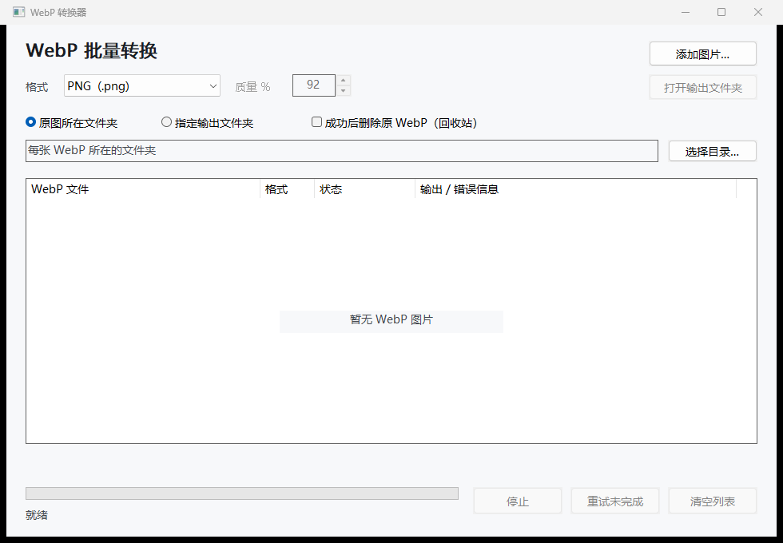

# WebpDrop / WebP 转换器

用 C 编写的 Windows 原生批量图片转换工具。只需运行 `WebpDrop.exe`，不需要安装或附带 DLL。

**[下载 Windows x64 单文件 EXE](https://github.com/tuolaji996/webp-drop/releases/latest/download/WebpDrop.exe)**



## 使用

- 默认转换成 PNG，默认保存在每张 WebP 所在的文件夹。
- 将全选的 WebP 拖进窗口，转换立即开始。也可以点击“添加图片”。
- 可以拖入整个文件夹，处理该文件夹内的 WebP，不递归处理子目录。
- 在拖入图片前，可以选择 JPEG 和质量，或选择统一的输出文件夹。
- 默认保留原文件。同名输出自动变成 `图片 (2).png`、`图片 (3).png` 等。
- 可以勾选“成功后删除原 WebP（回收站）”。仅在输出已成功保存时将对应原图移入回收站。
- 转换失败、停止、原文件发生变化或无法移入回收站时，原 WebP 保留，列表显示原因。重试采用当前复选框设置。
- 支持中文文件名、长路径、停止和重试。双击列表中的图片可打开输出文件夹。
- PNG 保留透明度；JPEG 使用白色背景，默认质量 92，采用 4:4:4 色度采样。
- 动画 WebP 输出第一帧。保留有效的 ICC 色彩配置，不复制 EXIF/XMP。

适用于 Windows 10/11 x64。单张源文件上限 256 MB，解码像素缓冲上限 512 MB。

## 源码和编译

`src/main.c` 是原生 GUI 和后台队列，`src/convert.c` 负责解码和保存。
WebP 解码使用静态编译的 libwebp 1.6.0；PNG/JPEG 使用 Windows Imaging Component。
程序系统菜单的“关于 WebP 转换器”内包含 libwebp 的许可全文。

```powershell
.\build.ps1
```

编译脚本下载固定版本的 Zig C 编译器和 libwebp，验证 SHA256，并放到项目内的 `.build-deps`。
它不安装全局开发工具。编译后的唯一运行文件是 `WebpDrop.exe`。

## 验证

使用 Python 3 和 Pillow 执行实际图片转换、像素对比、透明背景、色彩配置、长路径、动画首帧、同名文件和损坏文件验证。
所有验证图片及输出都在 `test-output` 内；可选的示例图片通过副本测试。

```powershell
.\build.ps1 -GuiTest
python -m pip install Pillow
python tests\verify.py --gui
```

也可以提供自己的示例文件夹：`python tests\verify.py '示例图片文件夹' --gui`。

GUI 验证直接向原生窗口投递包含多文件的 `WM_DROPFILES`，并验证停止、重试、自选目录、JPEG 格式和最小窗口布局。

也提供命令行批量转换入口：

```powershell
.\WebpDrop.exe --convert --png 'C:\Images\one.webp' 'C:\Images\two.webp'
.\WebpDrop.exe --convert --jpeg --quality 92 --output 'C:\Output' 'C:\Images\one.webp'
```

命令行返回码：0 表示全部成功，1 表示有图片失败，2 表示参数错误。输出目录需要已存在。

## 第三方许可

libwebp 使用 BSD 许可，完整文本见 [LIBWEBP-LICENSE.txt](LIBWEBP-LICENSE.txt)，并已内嵌到 EXE 的“关于”对话框。
